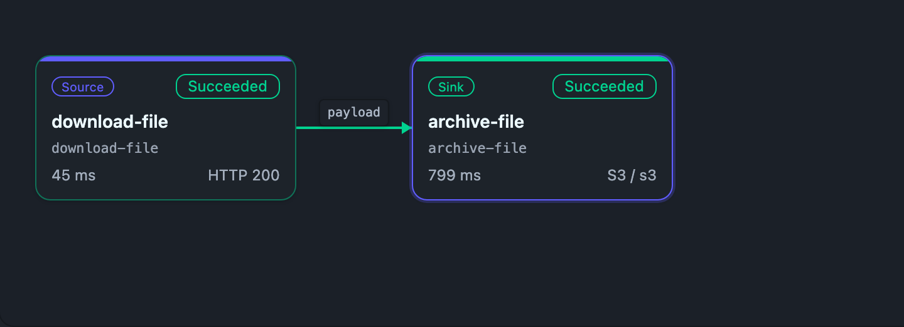

# Archive an opaque HTTP file without changing its bytes

HTTP application/octet-stream response → S3 format:file sink. No SQL, CSV parsing, spreadsheet conversion or historical file download is introduced.

Start with the [shared setup/run/cleanup guide](../../GUIDE.md). Commands below run from the repository root. [Spec](opaque-file-archive.pipeline.json), [bindings](bindings.template.json), [offline/target validation](validation.json), and [execution evidence](execution.json) are separate canonical records.

## Run lineage



Braidplane's lineage component rendered locally from the canonical spec and [archived execution receipt](execution.json) for run `bp1207-file-01` on 2026-10-18. This illustrates the recorded execution; it is not a fresh run or cloud-provider acceptance. [Capture provenance](../../lineage-captures.json) records the source files and renderer revision.

## Provider setup

Serve [fixtures/receipt.bin](fixtures/receipt.bin) from `/receipt.bin` on a synthetic HTTP endpoint reachable by the worker, using `Content-Type: application/octet-stream`. `/health` must succeed. Use [HTTP](../../connections/http.template.json) and [S3 destination](../../connections/s3-destination.template.json) templates and export their slugs as `RECIPE_HTTP_SOURCE` and `RECIPE_OBJECT_DEST`. Use a dedicated bucket/prefix with write access to the exact key recipes/receipt.bin.

Do not replace binary bytes with a JSON base64 wrapper or label arbitrary JSON as a file. A local fixture server on your laptop is not reachable from hosted workers. The explicit non-production provider must serve the canonical bytes; no customer file is needed.

For a self-hosted qualification worker that can reach this machine, serve only the canonical synthetic routes in another terminal:

```sh
export RECIPE_HTTP_BIND='<interface-address-reachable-by-your-worker>'
export RECIPE_HTTP_PORT='<available-port>'
python3 scripts/serve_http_fixtures.py --bind "$RECIPE_HTTP_BIND" --port "$RECIPE_HTTP_PORT"
```

Set the HTTP connection base_url to that server and health_check_path to /health. This is an unauthenticated test-only HTTP fixture, not an Internet deployment. For hosted execution, use your authorized reachable HTTPS fixture host with the same routes, bytes and content types. Stop the local fixture with Ctrl-C after the exercise.

## Operations and logical bindings

Create the exact saved operation on its destination before validation:

```sh
braidplane query create --data-source "$RECIPE_OBJECT_DEST" --name "Archive an opaque HTTP file without changing its bytes write" --slug opaque-file-archive-write --statement-file recipes/opaque-file-archive/operations/write.statement.json
```

Commit the canonical spec to your configured Git backend and import it as described in GUIDE.md, then bind the exact pipeline refs:

```sh
braidplane data-source-binding bind document-api --pipeline opaque-file-archive --data-source "$RECIPE_HTTP_SOURCE"
braidplane data-source-binding bind document-archive --pipeline opaque-file-archive --data-source "$RECIPE_OBJECT_DEST"
```

Use RECIPE_SLUG=opaque-file-archive for the shared validate/deploy/run/inspect commands. The selected environment is explicit; binding or importing does not execute the pipeline.

## Expected results and independent inspection

Independently download the actual destination object and compare both size and SHA256 from [expected.json](expected.json):

```sh
aws s3 cp "s3://$RECIPE_BUCKET/$RECIPE_PREFIX/recipes/receipt.bin" /tmp/recipe-receipt.bin
python3 - <<'CHECK'
import hashlib,json
from pathlib import Path
actual=Path('/tmp/recipe-receipt.bin').read_bytes()
expected=json.load(open('recipes/opaque-file-archive/expected.json'))
assert len(actual) == expected['size_bytes']
assert hashlib.sha256(actual).hexdigest() == expected['sha256']
CHECK
```

[execution.json](execution.json) binds the exact run/version, file sink events and observed independent byte comparison. The result location/digest is not a retained artifact, permission to fetch historical data, or proof that another external processor finished.

## Write and replay consequences

The saved S3 operation writes format:file to one deterministic object key with overwrite enabled. An explicit new run can replace that object. naturally_idempotent describes the selected write strategy, not indefinite safe replay, external consumption or automatic downstream execution. The byte digest is independently checked; source success alone cannot establish file delivery.

## Deliberate failure case

Before binding document-api, target validation must refuse the source with DATA_SOURCE_BINDING_NOT_FOUND. The observed [missing-binding receipt](negative/missing-binding.evidence.json) records that refusal without starting execution. Create the intended authorized binding in the selected enabled environment and validate again. Do not switch to a default environment or unrelated connection merely to pass.

## Cleanup

Remove only the output key with `aws s3 rm "s3://$RECIPE_BUCKET/$RECIPE_PREFIX/recipes/receipt.bin"`. Retire both bindings and the saved archive operation after consumers are removed. Configuration deletion does not undo a delivered object or delete the source fixture.
