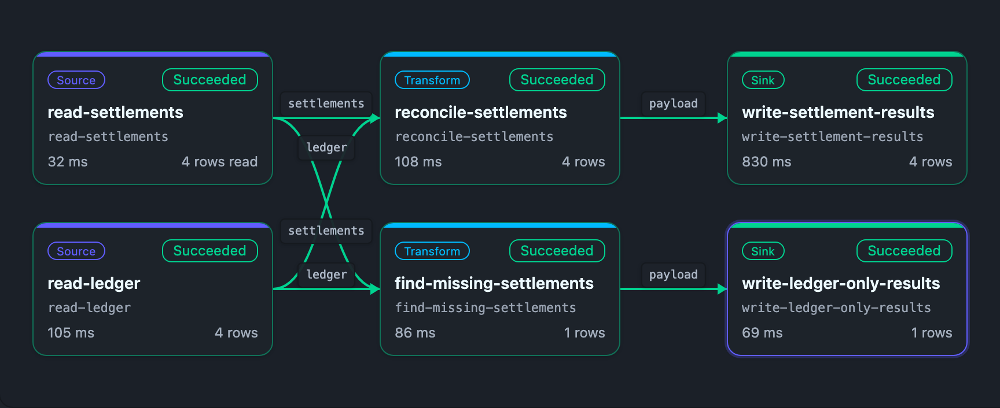

# Reconcile settlement payments and refunds with the ledger

S3 headered CSV + PostgreSQL ledger → named-input reconciliation and missing-settlement branches → two independent BigQuery appends. Payments, refunds and both unmatched directions remain visible.

Start with the [shared setup/run/cleanup guide](../../GUIDE.md). Commands below run from the repository root. [Spec](settlement-ledger-reconciliation.pipeline.json), [bindings](bindings.template.json), [offline/target validation](validation.json), and [execution evidence](execution.json) are separate canonical records.

## Run lineage



Braidplane's lineage component rendered locally from the canonical spec and [archived execution receipt](execution.json) for run `bp1207-reconciliation-01` on 2026-10-18. This illustrates the recorded execution; it is not a fresh run or cloud-provider acceptance. [Capture provenance](../../lineage-captures.json) records the source files and renderer revision.

## Provider setup

Use [PostgreSQL](../../connections/postgres.template.json), [S3 source](../../connections/s3-source.template.json), and [BigQuery destination](../../connections/bigquery.template.json) connections. Export their created slugs as `RECIPE_PG_SOURCE`, `RECIPE_OBJECT_SOURCE`, and `RECIPE_BIGQUERY_DEST`. The object-source prefix and the AWS CLI upload prefix must agree:

```sh
aws s3 cp recipes/settlement-ledger-reconciliation/fixtures/settlements.csv "s3://$RECIPE_BUCKET/$RECIPE_PREFIX/fixtures/settlements.csv"
psql 'service=recipe-source' -v ON_ERROR_STOP=1 -f recipes/settlement-ledger-reconciliation/fixtures/source.sql
```

Create a dedicated non-production Google Cloud project/dataset location. An administrator needs dataset/table creation rights for setup; the Braidplane destination service account needs only the required table append and metadata access. Store its service-account JSON outside this repository. Authenticate the bq tool through your own secure provider configuration. Create the dataset and exact schema once:

```sh
bq --project_id="$RECIPE_BQ_PROJECT" --location="$RECIPE_BQ_LOCATION" mk --dataset "$RECIPE_BQ_PROJECT:recipe_examples"
bq --project_id="$RECIPE_BQ_PROJECT" mk --table "$RECIPE_BQ_PROJECT:recipe_examples.settlement_reconciliation" recipes/settlement-ledger-reconciliation/bigquery-schema.json
```

[BigQuery table setup](https://docs.cloud.google.com/bigquery/docs/tables) is a provider operation; pipeline insert_rows does not create/evolve a table. The checked-in execution used a service-seeded local BigQuery protocol mock, not a Google Cloud account or the public connection-creation path.

## Operations and logical bindings

Create the exact saved operation on its destination before validation:

```sh
braidplane query create --data-source "$RECIPE_BIGQUERY_DEST" --name "Reconcile settlement payments and refunds with the ledger write" --slug settlement-ledger-reconciliation-write --statement-file recipes/settlement-ledger-reconciliation/operations/write.statement.json
```

Commit the canonical spec to your configured Git backend and import it as described in GUIDE.md, then bind the exact pipeline refs:

```sh
braidplane data-source-binding bind settlement-files --pipeline settlement-ledger-reconciliation --data-source "$RECIPE_OBJECT_SOURCE"
braidplane data-source-binding bind ledger-db --pipeline settlement-ledger-reconciliation --data-source "$RECIPE_PG_SOURCE"
braidplane data-source-binding bind reconciliation-warehouse --pipeline settlement-ledger-reconciliation --data-source "$RECIPE_BIGQUERY_DEST"
```

Use RECIPE_SLUG=settlement-ledger-reconciliation for the shared validate/deploy/run/inspect commands. The selected environment is explicit; binding or importing does not execute the pipeline.

## Expected results and independent inspection

Independently query the destination after both sink steps complete. With an empty table before the run, it must contain the five sorted records in [expected.json](expected.json): matching payment/refund, a 50-cent mismatch, a settlement missing from the ledger and a ledger item missing from settlements. Totals are settled 1800, ledger 1550 and difference 250 cents.

```sh
export RECIPE_BQ_TABLE="$RECIPE_BQ_PROJECT.recipe_examples.settlement_reconciliation"
bq query --use_legacy_sql=false --format=json "SELECT transaction_id, settled_cents, ledger_cents, difference_cents, reconciliation_status FROM \`$RECIPE_BQ_TABLE\` ORDER BY transaction_id" > /tmp/recipe-reconciliation.json
python3 - <<'CHECK'
import json
rows=json.load(open('/tmp/recipe-reconciliation.json'))
for row in rows:
    for field in ('settled_cents','ledger_cents','difference_cents'): row[field]=int(row[field])
assert rows == json.load(open('recipes/settlement-ledger-reconciliation/expected.json'))
assert [sum(row[k] for row in rows) for k in ('settled_cents','ledger_cents','difference_cents')] == [1800,1550,250]
CHECK
```

Provider INT64 display strings are normalized as exact integers, never floating point. [execution.json](execution.json) binds the controlled run, exact spec version, both sink events and independent protocol-mock readback.

## Write and replay consequences

Both branches append to the same table through one saved operation. The writes are independent: one can succeed while the other fails. An explicit new run can duplicate rows. deduplicated_by_ledger scopes the platform's own effect handling; it is not BigQuery exactly-once delivery or a global transaction. After partial/unknown effects, inspect each branch and the table before recovery. A fresh empty target is required to reproduce expected.json without prior-run rows.

## Cleanup

After confirming this is the table you created solely for the recipe, `bq rm -t "$RECIPE_BQ_PROJECT:recipe_examples.settlement_reconciliation"` removes its rows/schema. Remove only the uploaded fixture object with `aws s3 rm "s3://$RECIPE_BUCKET/$RECIPE_PREFIX/fixtures/settlements.csv"`. In the isolated source database, `DROP TABLE recipe_ledger;` removes its fixture. Preserve evidence before removing the three bindings and saved operation. Do not remove shared datasets/accounts.
