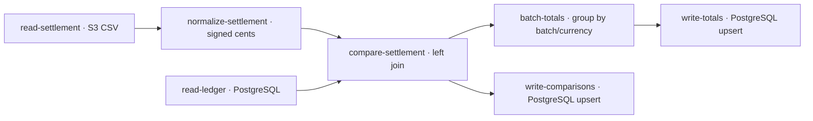

# Advanced settlement review — BP-1011 demo

Trace a settlement file through normalization, a composite-key left join, nullable exception rows, batch aggregation and two reporting writes. This is the seven-step fixture used by BP-1011's local UI rehearsal, preserved as a sixth example alongside the simpler BigQuery reconciliation.

S3 CSV + a PostgreSQL payment/refund ledger → comparison rows and batch totals → a separate PostgreSQL reporting database. The executed demo uses PostgreSQL for reporting; the earlier BigQuery story is not this fixture's provider evidence. Synthetic EUR amounts are integer cents, for investigation rather than accounting correction or complete bank reconciliation.

Start with the [shared guide](../../GUIDE.md), [full spec](settlement-review.pipeline.json), [bindings](bindings.template.json), [validation](validation.json) and [execution record](execution.json).

## Lineage and specification



The join matches provider event, event type and currency. Missing ledger values remain NULL, including difference; they are not converted to a zero discrepancy. Totals distinguish matched and unmatched counts and sum only known ledger values/differences. Both sinks have their own contracts and independent outcomes. The graph above describes spec dependencies; inspect the actual same-run lineage in your deployment for operational evidence.

## Isolated provider setup

Create separate source and reporting PostgreSQL databases, distinct from Braidplane's application database. Configure psql service aliases `recipe-source` and `recipe-reporting` outside Git. Use an administrator only to prepare these tables; the runtime source login needs SELECT, and the reporting login needs SELECT/INSERT/UPDATE on its two tables. Reporting tables must have no side-effecting triggers. Configure both connections from the [PostgreSQL template](../../connections/postgres.template.json), and the [S3 source template](../../connections/s3-source.template.json). Export their created slugs as `RECIPE_PG_SOURCE`, `RECIPE_PG_DEST` and `RECIPE_OBJECT_SOURCE`.

```sh
psql 'service=recipe-source' -v ON_ERROR_STOP=1 -f recipes/settlement-review/fixtures/source.sql
psql 'service=recipe-reporting' -v ON_ERROR_STOP=1 -f recipes/settlement-review/postgres-targets.sql
aws s3 cp recipes/settlement-review/fixtures/settlement.csv "s3://$RECIPE_BUCKET/$RECIPE_PREFIX/generated/settlement-review/settlement.csv"
```

The source connection's object prefix must equal `RECIPE_PREFIX`; its saved read appends `generated/settlement-review/settlement.csv`. Verify the uploaded bytes and the two ledger rows before running. Start with empty dedicated reporting tables and use only this synthetic evaluation.

## Saved operations and bindings

All four read/write operations are required; the two inspect operations are optional UI convenience queries. Create them on the appropriate concrete connection:

```sh
braidplane query create --data-source "$RECIPE_OBJECT_SOURCE" --name 'Read settlement' --slug read-settlement --statement-file recipes/settlement-review/operations/read-settlement.statement.json
braidplane query create --data-source "$RECIPE_PG_SOURCE" --name 'Read ledger' --slug read-ledger --statement-file recipes/settlement-review/operations/read-ledger.statement.json
braidplane query create --data-source "$RECIPE_PG_DEST" --name 'Write comparisons' --slug write-comparisons --statement-file recipes/settlement-review/operations/write-comparisons.statement.json
braidplane query create --data-source "$RECIPE_PG_DEST" --name 'Write totals' --slug write-totals --statement-file recipes/settlement-review/operations/write-totals.statement.json
braidplane query create --data-source "$RECIPE_PG_DEST" --name 'Inspect comparisons' --slug inspect-comparisons --statement-file recipes/settlement-review/operations/inspect-comparisons.statement.json
braidplane query create --data-source "$RECIPE_PG_DEST" --name 'Inspect totals' --slug inspect-totals --statement-file recipes/settlement-review/operations/inspect-totals.statement.json
```

Use connection-owned operation slugs only in a dedicated exercise; inspect existing resources before creating these names. Commit/import the complete Git directory as GUIDE.md explains, then bind this pipeline in your selected environment:

```sh
braidplane data-source-binding bind settlement-file --pipeline settlement-review --data-source "$RECIPE_OBJECT_SOURCE"
braidplane data-source-binding bind payment-ledger --pipeline settlement-review --data-source "$RECIPE_PG_SOURCE"
braidplane data-source-binding bind reporting-warehouse --pipeline settlement-review --data-source "$RECIPE_PG_DEST"
```

Set `RECIPE_SLUG=settlement-review` for the guide's target validation, exact-version deployment, manual run and inspection commands. In the UI, inspect Builder, then open the completed run's full lineage: all seven steps must succeed, with three comparison writes and one total write. Import, bindings and deployment are separate actions.

## Independent results

Read the reporting tables through your own database connection, independently of Braidplane's run acknowledgement:

```sh
psql 'service=recipe-reporting' -XAt -v ON_ERROR_STOP=1 -c "SELECT json_build_object('rows', COALESCE(json_agg(r), '[]'::json)) FROM (SELECT * FROM settlement_comparisons WHERE evaluation_id = 'settlement-demo-001' ORDER BY line_id) r" > /tmp/settlement-comparisons.json
psql 'service=recipe-reporting' -XAt -v ON_ERROR_STOP=1 -c "SELECT json_build_object('rows', COALESCE(json_agg(r), '[]'::json)) FROM (SELECT * FROM settlement_totals WHERE evaluation_id = 'settlement-demo-001' ORDER BY batch_id, currency) r" > /tmp/settlement-totals.json
python3 recipes/settlement-review/check-results.py /tmp/settlement-comparisons.json /tmp/settlement-totals.json
```

Compare all fields with [expected.json](expected.json). Expect three comparisons: a match, a refund difference of 500 cents and an unmatched line with NULL ledger/difference. One total reports gross 11000, fees 350, net 10650, matched ledger gross 8000 and matched difference 500 cents. The unmatched 2500 cents remain an exception, outside matched difference.

The historical [comparison readback](observed-comparisons.json) and [total readback](observed-totals.json) are synthetic destination evidence from 18 October 2026. Their archive hashes and the seven-step run/version identity were rechecked on 19 October; the spec, fixtures and operations were copied byte-for-byte from the preserved BP-1011 checkpoint. Public CLI alpha.6 also passed fresh offline validation. This reuse does not claim a new execution, current environment readiness, hosted acceptance or completion of the BP-1011 film. Runtime binary identity and immutable operation/binding snapshots were not retained in that run; see execution.json.

## Replay and cleanup

Both writes upsert by evaluation/line or evaluation/batch/currency. With unchanged inputs, stable keys and no side-effecting triggers, another manual run should retain three comparisons and one total; that rerun was not exercised by this publication check. Upserts do not remove rows absent from changed inputs, and the two tables are not updated atomically. Inspect both tables after a partial/unknown write before recovery.

After preserving evidence, remove only this exercise's object with `aws s3 rm "s3://$RECIPE_BUCKET/$RECIPE_PREFIX/generated/settlement-review/settlement.csv"`. In the dedicated source database, drop `settlement_demo_ledger`; in the dedicated reporting database, drop `settlement_comparisons` and `settlement_totals` using its administrator. Remove these three bindings and the six saved operations only after their consumers are removed. Do not drop shared databases or remove other evaluations.
