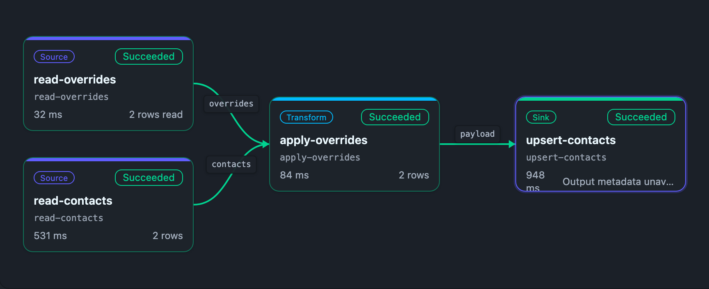

# Apply spreadsheet overrides before CRM upsert

S3 Excel worksheet rows + PostgreSQL contacts → named contacts/overrides left join with nonblank override precedence → HubSpot contact upsert. The workbook is normalized to rows by S3; spreadsheet is not a new pipeline representation.

Start with the [shared setup/run/cleanup guide](../../GUIDE.md). Commands below run from the repository root. [Spec](spreadsheet-contact-overrides.pipeline.json), [bindings](bindings.template.json), [offline/target validation](validation.json), and [execution evidence](execution.json) are separate canonical records.

## Run lineage



Braidplane's lineage component rendered locally from the canonical spec and [archived execution receipt](execution.json) for run `bp1207-overrides-02` on 2026-10-18. This illustrates the recorded execution; it is not a fresh run or cloud-provider acceptance. [Capture provenance](../../lineage-captures.json) records the source files and renderer revision.

## Provider setup

Use a dedicated HubSpot developer test account without enabled contact workflows. Create a contact property named `external_customer_id`, type string, configured as unique; grant the test private app contact read/write and access to that property. The writer also needs email and firstname. Imported contacts do not authorize emails, subscriptions or other outreach.

Use [S3 source](../../connections/s3-source.template.json), [PostgreSQL](../../connections/postgres.template.json), and [HubSpot](../../connections/hubspot.template.json) connection templates. Export their slugs as `RECIPE_OBJECT_SOURCE`, `RECIPE_PG_SOURCE`, and `RECIPE_HUBSPOT_DEST`. Load the canonical fixtures:

```sh
aws s3 cp recipes/spreadsheet-contact-overrides/fixtures/overrides.xlsx "s3://$RECIPE_BUCKET/$RECIPE_PREFIX/fixtures/overrides.xlsx"
psql 'service=recipe-source' -v ON_ERROR_STOP=1 -f recipes/spreadsheet-contact-overrides/fixtures/source.sql
```

The workbook has sheet Overrides, range A1:B3, header customer_id/first_name, one Alexandra override and one blank fallback. Do not replace it with CSV or depend on evaluated spreadsheet formulas. Braidplane reads the selected worksheet/range; it does not evaluate formulas or preserve workbook styling on writes. The qualified CRM provider was a local protocol mock; no real HubSpot account was exercised.

## Operations and logical bindings

Create the exact saved operation on its destination before validation:

```sh
braidplane query create --data-source "$RECIPE_HUBSPOT_DEST" --name "Apply spreadsheet overrides before CRM upsert write" --slug spreadsheet-contact-overrides-write --statement-file recipes/spreadsheet-contact-overrides/operations/write.statement.json
```

Commit the canonical spec to your configured Git backend and import it as described in GUIDE.md, then bind the exact pipeline refs:

```sh
braidplane data-source-binding bind override-workbook --pipeline spreadsheet-contact-overrides --data-source "$RECIPE_OBJECT_SOURCE"
braidplane data-source-binding bind contact-db --pipeline spreadsheet-contact-overrides --data-source "$RECIPE_PG_SOURCE"
braidplane data-source-binding bind contact-crm --pipeline spreadsheet-contact-overrides --data-source "$RECIPE_HUBSPOT_DEST"
```

Use RECIPE_SLUG=spreadsheet-contact-overrides for the shared validate/deploy/run/inspect commands. The selected environment is explicit; binding or importing does not execute the pipeline.

## Expected results and independent inspection

Independently inspect the two test contacts in the provider, filtering exact external_customer_id c-1/c-2. c-1 must be Alexandra; c-2 must remain Sam; both synthetic email addresses must match [expected.json](expected.json). The upsert acknowledgement alone is insufficient.

For a separate authorized read through the CLI, [operations/readback.statement.json](operations/readback.statement.json) supplies the complete bounded search:

```sh
braidplane query create --data-source "$RECIPE_HUBSPOT_DEST" --name 'Recipe contact readback' --slug spreadsheet-contact-overrides-readback --statement-file recipes/spreadsheet-contact-overrides/operations/readback.statement.json
braidplane query execute spreadsheet-contact-overrides-readback --data-source "$RECIPE_HUBSPOT_DEST" > /tmp/recipe-crm-readback.json
python3 - <<'CHECK'
import json
result=json.load(open('/tmp/recipe-crm-readback.json'))
rows=[{'customer_id':r['external_customer_id'],'email':r['email'],'first_name':r['firstname']} for r in result['payload']['rows']]
rows.sort(key=lambda r:r['customer_id'])
assert rows == json.load(open('recipes/spreadsheet-contact-overrides/expected.json'))
CHECK
```

The checked-in [execution receipt](execution.json) used a direct independent mock-provider read, with the exact run/version and step events retained. Your account has its own provider record IDs; do not substitute local mock IDs.

## Write and replay consequences

The unique external customer key controls updates. Repeating the same mapping can update existing test contacts; it does not promise an atomic batch or exactly-once outreach. A partial batch can have successful contact changes even when the run fails. Inspect actual records before retry/replay. The blank override intentionally retains the database name; it is not a request to clear a CRM property.

## Cleanup

Remove only the two isolated test contacts identified by external_customer_id c-1/c-2 using the provider's normal record-deletion flow. Keep any property/private app owned by another exercise. Remove the uploaded workbook with `aws s3 rm "s3://$RECIPE_BUCKET/$RECIPE_PREFIX/fixtures/overrides.xlsx"`; in the isolated source database, `DROP TABLE recipe_contacts;` removes its fixture. Remove the three bindings and recipe saved operations after their consumers are retired.
